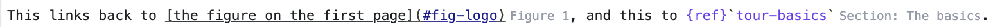

# codemirror-lsp-inlay-hints

Inlay hints for [`@codemirror/lsp-client`](https://github.com/codemirror/lsp-client), the CodeMirror editor's client for language servers.

Inlay hints are the small labels a language server places in your code.
For example, a parameter's name before an argument, or a variable's type after it.
In MyST, a hint after a reference can show what it points to, like `Figure 1`.
`@codemirror/lsp-client` doesn't show them, so this package adds them as an extension for `LSPClient`.



## Install

```sh
npm install codemirror-lsp-inlay-hints
```

It uses your project's `@codemirror/lsp-client`, `@codemirror/state` and `@codemirror/view`.

## Use

Add `inlayHints()` to your client's extensions:

```ts
import { LSPClient, languageServerExtensions } from '@codemirror/lsp-client';
import { inlayHints } from 'codemirror-lsp-inlay-hints';

const client = new LSPClient({ extensions: [...languageServerExtensions(), inlayHints()] });
```

Each editor asks the server for hints when it opens, and again 300 ms after the last edit.
Nothing happens if the server doesn't support inlay hints.

### Options

`inlayHints({ delay })` sets how many milliseconds to wait after the last edit before asking again.
It defaults to `300`.
`delay: null` turns off automatic requests, so hints only come from calling `refreshInlayHints` (see below).

### Refresh hints yourself

A file's hints can change without an edit to that file.
For example, a reference's label changes when someone edits the file it points to.
Servers announce this with a `workspace/inlayHint/refresh` request.
`@codemirror/lsp-client` doesn't handle requests from the server yet ([#1](https://github.com/choldgraf/codemirror-lsp-inlay-hints/issues/1)).

So call `refreshInlayHints(view)` when you know the hints are out of date.
Some servers re-publish diagnostics (errors and warnings) when another file changes, so new diagnostics are a handy trigger.
[MyST Author](https://github.com/choldgraf/myst-author) does this with [mystmd-lsp](https://github.com/choldgraf/mystmd-lsp):

```ts
import { LSPClient, languageServerExtensions, type LSPClientExtension } from '@codemirror/lsp-client';
import { inlayHints, refreshInlayHints } from 'codemirror-lsp-inlay-hints';

const refreshOnDiagnostics: LSPClientExtension = {
  notificationHandlers: {
    'textDocument/publishDiagnostics': (client, params) => {
      const view = client.workspace.getFile(params.uri)?.getView();
      if (view) refreshInlayHints(view);
      return false; // keep going, so lsp-client still shows the diagnostics
    },
  },
};

// Handlers run in order until one returns true.
// languageServerExtensions() has a diagnostics handler that does, so put this one first.
const client = new LSPClient({ extensions: [inlayHints(), refreshOnDiagnostics, ...languageServerExtensions()] });
```

`refreshInlayHints` never rejects.
If the request fails, the old hints stay.
Some servers, like mystmd-lsp, also send diagnostics when a file opens and after every edit.
If you refresh on diagnostics with one of those, use `inlayHints({ delay: null })` so you don't ask twice.

### Style

Each hint is a `<span class="cm-inlay-hint">`, which also gets these classes:

| Class | When |
| --- | --- |
| `cm-inlay-hint-type` | The server marks it as a type hint |
| `cm-inlay-hint-parameter` | The server marks it as a parameter hint |
| `cm-inlay-hint-padding-left`, `cm-inlay-hint-padding-right` | The server asks for space on that side |

Hints are grey and slightly smaller than the text.
Override that with a theme:

```ts
EditorView.theme({ '.cm-inlay-hint': { color: 'teal', fontStyle: 'italic' } });
```

If the server sends a tooltip, it becomes the hint's `title`.

## How it works

- It asks for the whole document's hints and shows each one as a widget at its position.
- Hints move with the text while you type, until the next response replaces them.
- It ignores a response if the document changed or a newer request was sent in the meantime.

## Not supported yet

- Receiving `workspace/inlayHint/refresh` from the server (see [Refresh hints yourself](#refresh-hints-yourself)).
- Asking only for the visible part of the document, which matters for very long files.
- `inlayHint/resolve`.
- Clickable label parts.
- A hint's `textEdits`.

Issues and pull requests for any of these are welcome.
See [Contributing](docs/contributing.md).
